<!-- HEADER BANNER -->
<p align="center">
  
</p>

<!-- ANIMATED TERMINAL TYPING -->
<p align="center">
  <a href="https://abdulgani.vercel.app/" target="_blank">
    
  </a>
</p>

<!-- SOCIAL & PROFILE VIEWS -->
<p align="center">
  <a href="https://abdulgani.vercel.app/" target="_blank">
    
  </a>
  &nbsp;
  <a href="https://www.linkedin.com/in/muhamad-abdul-gani-a60b42310" target="_blank">
    
  </a>
  &nbsp;
  <a href="mailto:uding847@gmail.com">
    
  </a>
  &nbsp;
  
</p>

<p align="center"></p>

### `>_` `cat profile.ts`

```ts
const developer = {
  name    : "Muhamad Abdul Gani",
  alias   : "Ghani",
  location: "Semarang, Indonesia 🇮🇩",
  campus  : "PTIK — Universitas Negeri Semarang (UNNES)",

  focusAreas: [
    "Full-Stack Web Development",
    "AI & Computer Vision",
    "Data Analysis & Visualization",
  ],

  currentlyBuilding: [
    "Gamas Rent      — Event Equipment Rental Platform",
    "ANTARIN         — Campus Mobility & Jastip Prototype",
    "Interactive Web Evaluation Media",
  ],

  currentlyLearning : ["Docker", "CI/CD Pipelines", "Deep Learning (YOLOv8)"],
  hobbies           : ["Volleyball 🏐", "Soccer ⚽", "Coding 💻"],
  openTo            : "Internship · Freelance · Collaborative Tech Projects",
  funFact           : "I debug better at night ☕",
};
```

<p align="center"></p>

### `>_` Tech Stack & Arsenal

<div align="center">

**🖥️ Frontend & UI**
<br />


<br /><br />

**⚙️ Backend & Database**
<br />


<br /><br />

**🤖 AI, Data & ML**
<br />


<br /><br />

**🛠️ Dev Tools & Platforms**
<br />


</div>

<p align="center"></p>

### `>_` Proyek Unggulan

<div align="center">

| 🚀 Proyek | 📋 Deskripsi | 🔧 Stack | 🔗 Tautan |
| :--- | :--- | :--- | :---: |
| **Gamas Rent** | Platform rental perlengkapan acara dengan cek ketersediaan *real-time*, *conflict prevention*, checkout via WhatsApp & dashboard admin lengkap | `Next.js` `TypeScript` `Tailwind` | [Repo](https://github.com/abdulgani89/gamasrent) · [Live](https://gamasrent.vercel.app) |
| **ANTARIN** | Prototipe interaktif & MVP frontend untuk layanan *ride-hailing* (Anjem) dan *jastip* di lingkungan kampus UNNES | `Next.js` `TypeScript` `Tailwind` | [Repo](https://github.com/abdulgani89/antarin-frontend) |
| **Sistem Perpustakaan** | Aplikasi perpustakaan *multi-role* (Admin, Kepala, Siswa) dengan tracking buku hilang & analitik Chart.js | `Laravel` `PHP` `MySQL` `Chart.js` | [Repo](https://github.com/abdulgani89/sistem-perpustakaan) |
| **Sistem Akademik Siswa** | Sistem Informasi Akademik *full-stack* dengan dashboard dan hak akses terpisah untuk Admin, Guru & Siswa | `Python` `Django` | [Repo](https://github.com/abdulgani89/SistemAkademikSiswa) |
| **Kuis Interaktif** | Aplikasi evaluasi dan kuis berbasis web dengan umpan balik langsung & tracking skor | `TypeScript` `Vercel` | [Repo](https://github.com/abdulgani89/Kuisi_interaktif) · [Live](https://kuisinteraktif-gamma.vercel.app) |
| **Potret Waktu** | Website *company profile* & portofolio fotografi responsif dengan galeri karya & testimoni klien | `HTML` `CSS` `JavaScript` | [Repo](https://github.com/abdulgani89/CP_Potretwaktu) · [Live](https://potretwaktu.vercel.app) |

</div>

<p align="center"></p>

### `>_` GitHub Telemetry & Activity

<p align="center">
  
  &nbsp;
  
</p>

<p align="center">
  
</p>

<p align="center">
  
</p>

<p align="center"></p>

### `>_` ⚽ Soccer × Volleyball × Code 🏐

> *"Where the pitch meets the court, and both meet the terminal."*

<p align="center">
  
</p>

<p align="center"></p>

### `>_` Let's Connect!

<p align="center">
  <i>Saya selalu terbuka untuk berdiskusi tentang teknologi, kolaborasi proyek, maupun peluang karir.</i>
  <br /><br />
  <a href="https://abdulgani.vercel.app/" target="_blank">
    
  </a>
  &nbsp;
  <a href="https://www.linkedin.com/in/muhamad-abdul-gani-a60b42310" target="_blank">
    
  </a>
  &nbsp;
  <a href="mailto:uding847@gmail.com">
    
  </a>
</p>

<!-- FOOTER -->
<p align="center">
  <svg xmlns="http://www.w3.org/2000/svg" width="1200" height="80" viewBox="0 0 1200 80">
    <defs>
      <linearGradient id="footer-grad" x1="0%" y1="0%" x2="100%" y2="0%">
        <stop offset="0%"   stop-color="#00d4ff"/>
        <stop offset="50%"  stop-color="#162447"/>
        <stop offset="100%" stop-color="#0d1117"/>
      </linearGradient>
    </defs>
    <rect width="1200" height="80" fill="#0d1117"/>
    <path d="M0,0 Q300,40 600,25 Q900,10 1200,35 L1200,80 L0,80 Z" fill="url(#footer-grad)" opacity="0.5"/>
    <rect x="0" y="0" width="1200" height="3" fill="url(#footer-grad)" opacity="0.6"/>
  </svg>
</p>
